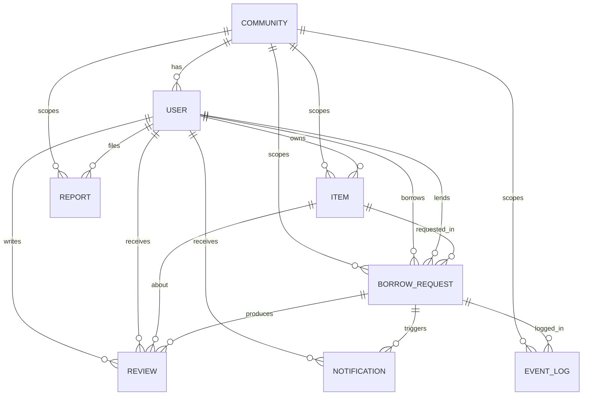

# Entity Relationship Diagram



## Collections

### Community

| Field | Type | Notes |
|---|---|---|
| _id | ObjectId | |
| name | string | |
| slug | string | unique |
| type | enum | campus, hostel, apartment, other |
| joinPolicy | enum | email_domain, invite_code |
| emailDomains | string[] | required when joinPolicy = email_domain |
| inviteCodeHash | string | required when joinPolicy = invite_code |
| center | GeoJSON Point | |
| status | enum | active, suspended |
| createdAt, updatedAt | Date | |

Indexes: `{slug:1}` unique; `{center:'2dsphere'}`.

### User

| Field | Type | Notes |
|---|---|---|
| _id | ObjectId | |
| communityId | ObjectId | |
| email | string | lowercase, unique globally |
| passwordHash | string | select:false |
| name | string | |
| avatarUrl | string | |
| role | enum | member, community_admin |
| status | enum | pending_verification, active, suspended |
| emailVerifiedAt | Date | |
| verificationTokenHash | string | select:false |
| verificationExpiresAt | Date | |
| sessions | {jtiHash, expiresAt, createdAt}[] | refresh token rotation, select:false |
| ratingSum, ratingCount | number | denormalized; reputation formula deferred to Stage 8 |
| createdAt, updatedAt | Date | |

Indexes: `{email:1}` unique; `{communityId:1, status:1}`; `{verificationTokenHash:1}` sparse.

### Item

| Field | Type | Notes |
|---|---|---|
| _id | ObjectId | |
| communityId | ObjectId | |
| ownerId | ObjectId | |
| title, description | string | |
| category | enum | |
| condition | enum | new, good, fair |
| images | {url, publicId, width, height}[] | 1 to 8 |
| terms | {minLoanDays, maxLoanDays, rules, pickupNotes} | |
| areaLabel | string | shown in discovery |
| location | GeoJSON Point | approximate, jittered at write time, used for discovery |
| privateAddress | {line, point} | select:false; readable only by owner and borrower of an Approved, Handed over, or Overdue request |
| reservations | {requestId, startDate, endDate}[] | concurrency guard, one entry per approved or active request |
| status | enum | active, paused, archived |
| createdAt, updatedAt | Date | |

Indexes: `{communityId:1, location:'2dsphere'}`; `{communityId:1, status:1, category:1, createdAt:-1}`; `{communityId:1, title:'text', description:'text'}`; `{ownerId:1, status:1}`.

#### Concurrency Guard

Executed inside the approval transaction:

```js
Item.updateOne(
  {
    _id: itemId,
    communityId,
    status: 'active',
    reservations: { $not: { $elemMatch: { startDate: { $lte: end }, endDate: { $gte: start } } } }
  },
  { $push: { reservations: { requestId, startDate: start, endDate: end } } },
  { session }
)
```

`matchedCount === 0` aborts the transaction and returns 409.

### BorrowRequest

| Field | Type | Notes |
|---|---|---|
| _id | ObjectId | |
| communityId, itemId, ownerId, borrowerId | ObjectId | ownerId denormalized from Item |
| status | enum | requested, approved, handed_over, returned, closed, rejected, cancelled, overdue, disputed |
| disputedFrom | enum | status before dispute |
| startDate, endDate | Date | |
| message | string | |
| decision | {by, reason, kind} | kind: rejected, cancelled, auto_rejected |
| handover | {submittedAt, photos[], notes, confirmedAt} | photos: {url, publicId} |
| return | {recordedAt, photos[], notes, condition} | condition: as_expected, damaged |
| dispute | {openedBy, openedAt, reason, resolutionNote, resolvedBy, resolvedAt} | |
| approvedAt, handedOverAt, dueAt, returnedAt, closedAt | Date | |
| createdAt, updatedAt | Date | |

Indexes: `{communityId:1, itemId:1, status:1}`; `{borrowerId:1, status:1, createdAt:-1}`; `{ownerId:1, status:1, createdAt:-1}`; `{status:1, dueAt:1}`; partial unique `{itemId:1, borrowerId:1}` where status in (requested, approved, handed_over, overdue, disputed).

### Review

| Field | Type | Notes |
|---|---|---|
| _id | ObjectId | |
| communityId, requestId, itemId | ObjectId | |
| reviewerId, revieweeId | ObjectId | |
| reviewerRole | enum | borrower, owner |
| rating | number | 1 to 5 |
| comment | string | max 1000 |
| createdAt | Date | |

Indexes: `{requestId:1, reviewerId:1}` unique; `{revieweeId:1, createdAt:-1}`; `{itemId:1, createdAt:-1}`.

### Notification

| Field | Type | Notes |
|---|---|---|
| _id | ObjectId | |
| communityId, userId | ObjectId | |
| type | string | e.g. request.received |
| requestId | ObjectId | optional |
| payload | object | |
| readAt | Date | |
| createdAt | Date | |

Indexes: `{userId:1, readAt:1, createdAt:-1}`; TTL `{createdAt:1}` 90 days.

### Report

| Field | Type | Notes |
|---|---|---|
| _id | ObjectId | |
| communityId, reporterId | ObjectId | |
| targetType | enum | user, item, request, review |
| targetId | ObjectId | |
| reason | enum | |
| details | string | |
| status | enum | open, reviewing, resolved, dismissed |
| resolvedBy | ObjectId | |
| resolutionNote | string | |
| createdAt, resolvedAt | Date | |

Indexes: `{communityId:1, status:1, createdAt:-1}`; `{targetType:1, targetId:1}`. Schema fixed now; model and endpoints built in Stage 8, except the dispute-linked write in T12.

### EventLog

| Field | Type | Notes |
|---|---|---|
| _id | ObjectId | |
| communityId | ObjectId | |
| entityType | enum | borrow_request, item, user, community |
| entityId | ObjectId | |
| action | string | e.g. request.approved |
| fromStatus, toStatus | string | null for non-transition events |
| actorType | enum | user, system |
| actorId | ObjectId | null for system |
| correlationId | string | per-request id |
| metadata | object | |
| createdAt | Date | |

Indexes: `{entityType:1, entityId:1, createdAt:1}`; `{communityId:1, createdAt:-1}`. Written inside the same transaction as the change it records.
